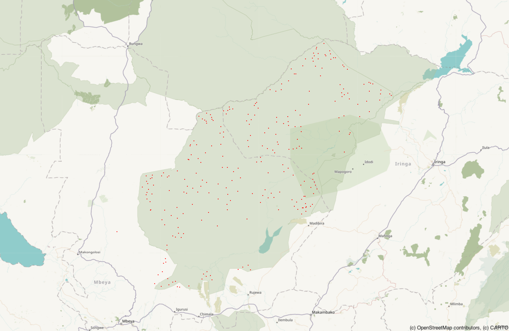

# Plotting Poaching Density in Tanzania — Dot Density, Histogram and Voronoi Maps

CISC7204 Suggested Exercise 08 (Practice 01) — a geoplotlib study of where poaching
incidents concentrate, using three of its layer types on the same dataset.

[](dot_density.png)

## The problem / research question

Wildlife poaching incidents are reported as isolated latitude/longitude points, which
are hard to read as a table. The question this project answers is: **where do poaching
incidents concentrate in Tanzania, and which layer type — dot density, histogram or
Voronoi tessellation — makes that concentration pattern easiest to see?**

## Dataset source and usage permissions

- `poaching_points_cleaned.csv` — 268 poaching incidents (id_report, date_report,
  description, created_date, lat, lon), provided through the CISC7204 Tutorial 08-01
  course notes (UMMoodle, 2026-2027 Semester 1) for educational use in this course.
- Basemap tiles: © [OpenStreetMap contributors](https://www.openstreetmap.org/copyright),
  rendered through the Humanitarian tile style (a.tile.openstreetmap.fr).

No passwords, API keys, personal data or restricted datasets are contained in this
repository.

## Methods and tools used

- Python 3.10 in a dedicated conda environment (`geoplotlib-legacy`)
- [geoplotlib 0.3.2](https://github.com/andrea-cuttone/geoplotlib) — dot, histogram and
  Voronoi layers, `read_csv` DataAccessObject
- pandas 2.2.3 / numpy 1.26.4 for the data table, pyglet 1.5 for the window system
- Jupyter Notebook; maps are rendered offscreen (geoplotlib `savefig`) because the
  interactive window cannot be captured inside a notebook — the notebook documents the
  compatibility workarounds (legacy `np.int`/`np.float` names, a tile-loader fix, and
  child-process rendering) in the cells where they appear

## Key findings and one limitation

- The 268 incidents span roughly lat −8.65 to −6.93 and lon 33.44 to 35.40, in and
  around the Ruaha landscape of central Tanzania.
- The dot density map shows a dense cluster inside the park boundaries; the histogram
  layer highlights the same hotspots and the empty buffer zones around them; the
  Voronoi tessellation (Blues_r, max_area 1e5) exposes one large dark-blue cell at the
  centre-right edge that the histogram understates.
- **Limitation:** the table carries no severity, species or outcome fields, and all 268
  rows share the same description, so the maps show *where* incidents happen but cannot
  say *how serious* each one was; conclusions about causes would need additional data.

## Instructions for running the analysis

1. Install [Anaconda](https://www.anaconda.com/) or Miniconda.
2. Create the environment (from the course environment guide):
   ```bash
   conda create -n geoplotlib-legacy python=3.10 -y
   conda activate geoplotlib-legacy
   python -m pip install "setuptools==57.5.0" wheel
   python -m pip install --no-build-isolation "geoplotlib==0.3.2"
   python -m pip install ipykernel "pyglet>=1.5,<2" "pandas==2.2.3" "numpy==1.26.4" \
       matplotlib scipy pyshp
   python -m ipykernel install --user --name geoplotlib-legacy \
       --display-name "Python (geoplotlib legacy)"
   ```
3. Start Jupyter (`jupyter notebook`), open `Exercise8.01.ipynb`, select the kernel
   **Python (geoplotlib legacy)** and run the cells in order. The dataset is expected
   two directories above the notebook (`../../Datasets/poaching_points_cleaned.csv`);
   adjust the path if you place it elsewhere.
4. Alternatively run `requirements.txt` in any Python 3.10 environment:
   `pip install -r requirements.txt`.

## Repository contents

```
Exercise8.01.ipynb          executed notebook (code + maps)
poaching_points_cleaned.csv dataset (268 rows)
requirements.txt            pinned dependencies
dot_density.png / histogram.png / voronoi.png   the three maps (PNG)
```
